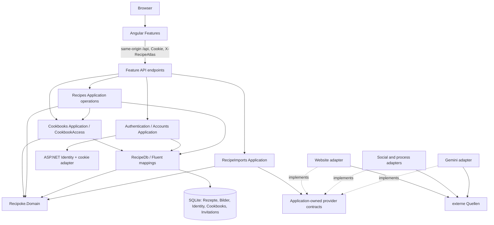

# Recipoke: Architektur und Entwurfsentscheidungen

## Ziel und Geltungsbereich

Recipoke ist eine einladungsbasierte Rezeptanwendung mit individuellen Konten und geteilten Cookbooks: ein ASP.NET-Core-Prozess, eine SQLite-Datenbank und ein Angular-Frontend. Owner, Editor und Viewer begrenzen den Zugriff pro Cookbook. Globale Account-Administration gewährt keinen automatischen Inhaltszugriff. Offline-Synchronisation, Shopping Lists und Cooking Sessions sind weiterhin nicht implementiert.

Der vorhandene Architekturhybrid bleibt bestehen. [Account-Runbook](../accounts-and-cookbooks.md) und ADR 009–012 dokumentieren die neue Produktanforderung; ADR 001–008 beschreiben die frühere Refactoring-Basis, soweit nicht ausdrücklich ersetzt.

Die Architektur ist ein bewusster **Hybrid aus featureorientiertem Monolith und unabhängiger Domain-Assembly**. Sie ist keine strikte Clean Architecture: ausgewählte Application-Operationen verwenden EF Core direkt. Zusätzliche Application-/Infrastructure-Projekte, generische Repositories und eine weitere Unit-of-Work-Abstraktion würden hier die vorhandenen Verantwortlichkeiten überwiegend verdoppeln.

Die ADRs in [adr/](adr/) dokumentieren Kontext, Alternativen, Konsequenzen und überprüfbare Grenzen. Die technische Form ist eine Entscheidung für Recipoke, keine Vorgabe eines Studienmoduls.

## Historischer Refactoring-Ausgangspunkt

| Repository | Ausgangscommit auf `main` | Ausgangszustand |
|---|---|---|
| Backend | `580fce9b8fb8c272b1acc70e6d698f4b94a61f3b` | sauber, mit Recipoke-Rename und allen vorhandenen Importen |
| Frontend | `9cdc6e03accd8765cfd49394f152ebf26bf71d14` | sauber, mit Recipoke-Rename und allen vorhandenen Importen |

Remote-Referenzen wurden vor der Bearbeitung geladen. Es war kein Feature-Merge erforderlich. Baseline: Backend-Build ohne Warnungen/Fehler, 567 deterministische Prüfungen, 62 HTTP-Prüfungen, identische gemeinsame Fixtures und kein ausstehender EF-Modellunterschied; Frontend-Build und 134 Tests erfolgreich.

Nach dem Refactoring: 595 Prüfungen im expliziten Backend-Runner, 63 HTTP-Prüfungen, 137 Angular-Tests. Ein zusätzlicher Upgrade-Smoke mit einer aus dem archivierten Ausgangscommit publizierten API prüft vorhandene Cookies, Schlüssel, Rezept-/Bilddaten und identische Migrationshistorie. Dazu kommen generierter OpenAPI-Vergleich, lokale Cross-Repository-Prüfung und der Frontend-Vertragschecker. Die HTTP-Erweiterung prüft insbesondere, dass weiterhin die Bildsignatur und nicht ein behaupteter MIME-Typ entscheidet. Browser-Layouts wurden nicht visuell neu vermessen; Templates und Styles bleiben unverändert. Live-Scraping, bezahlte Modellaufrufe und öffentliche TLS-Bereitstellung sind nicht Bestandteil dieser Aussage.

## Account-/Cookbook-Erweiterung: Baseline und Nachweise

Die bereits vorhandenen Feature-Branches `feature/accounts-and-cookbooks` wurden ohne Merge/Rebase ausgecheckt. Saubere Ausgangscommits: Backend `3dfedcf7ce87cffdbae127346be91ce429496f85`, Frontend `add4bc4a3ff57cf34d95b42b8e0298670e576119`. Beide enthielten Rename, Imports und abgeschlossene Refactoring-Funktionen. `main` wird durch diese Aufgabe nicht verändert. Baseline: 595 Backend-, 63 HTTP- und 137 Frontend-Prüfungen sowie beide Builds erfolgreich.

Abschluss der ursprünglichen Account-Erweiterung (historisch): 621 Console-Prüfungen, 63 bestehende und 153 Account-/Cookbook-HTTP-Prüfungen plus Race-/Hash-Speicher-Assertions, 166 Frontend-Tests und 146 Transport-Vertragsprüfungen. Der optionale echte Alt-Binär-Upgrade-Test prüft Daten-/Schlüsselbestand, geschlossene Setup-Phase, abgewiesene Owner-Cookies, Recovery und Production-Cookieattribute. CI führt die normalen Suiten mit synthetischem SQLite aus. Zusätzlich bestanden 21 automatisierte Prüfungen in echtem Chromium 154 bei 320/1280px: Invitation, Profilanlage, Sharing, Rename, Rollen, widerrufener Editor-Save mit erhaltenen Eingaben, Discard-Dialog, Logout, Deaktivierung/Reaktivierung, Passwortwechsel, Invite-Revoke und Cookbook-Erstellung. Gemessen wurde auch horizontaler Overflow; dies ist keine vollständige visuelle Begutachtung. Ein gehosteter GitHub-Lauf, Container-/TLS-Betrieb und Live-Provider sind separate Nachweise.

## Tatsächliche Struktur

```text
backend/
  Recipoke.Domain/
    Recipes/                 # Recipe, Ingredient, RecipeStep, RecipeImage
    Quantities/              # Ausdrucksparser, Rational, Konversion, Einheitenpolitik
    Cookbooks/               # Cookbook, Membership, Rollen-/Fähigkeitsregeln
    Accounts/                # reine Invitation-Zustandsregel
  RecipeAtlas.Api/            # absichtlich stabiler Content Root; Recipoke.Api.csproj
    Program.cs               # sichtbarer Composition Root und Startup-Migration
    Features/
      Authentication/
        Api/                 # HTTP-Cookie-Endpunkte
        Application/         # Login, Passwortwechsel, Active-Checks, CurrentUser/Session-Ports
        Infrastructure/      # Identity-Sitzungen, HttpCurrentUser
      Accounts/
        Api/                 # Admin-/Invite-Endpunkte und geschlossene Setup-Phase
        Application/         # Kontostatus, atomare Einladungen und Admin-Setup
        AdministratorCommands.cs # verdeckte serverseitige Eingabe
      Cookbooks/
        Api/                 # Cookbook-/Member-Endpunkte
        Application/         # konkrete Operationen und zentrale CookbookAccess-Regel
      Recipes/
        Api/                 # Bindung und HTTP-Abbildung
        Application/         # Create/Update/Delete/Get/List und Bildoperationen
        Mapping/             # explizite Command-/Antwort-Abbildung
      RecipeImports/
        Api/                 # Import-Request und HTTP-Fehlerabbildung
        Application/         # Auswahl, Richtlinie, Interpretation und externe Ports
        Contracts/           # Import-Request, Entwurf, Ergebnis, bestehende Fehlerdaten
        Infrastructure/
          Website/           # sichere HTTP-Abholung und JSON-LD-Interpretation
          Social/            # Redirect-Auflösung, yt-dlp und begrenzter Prozess
          TextExtraction/    # Gemini-Adapter
    Infrastructure/Persistence/
      RecipeDb.cs
      AppUser.cs             # Identity-Persistenztypen, außerhalb Domain
      RecipeDbFactory.cs
      Configurations/        # Fluent API je vorhandener Entität
      Migrations/            # alte IDs erhalten; additive AccountsAndCookbooks-Migration
    Common/Application/      # kleiner operationsbezogener Fehler, kein Result-Framework
    Common/Http/             # Schreibschutz, Fehlerabbildung und OpenAPI
contracts/                   # generierter OpenAPI-Snapshot
scripts/                     # isolierter Export und explizite Frontend-Synchronisation
tests/Recipoke.Tests/         # bestehender Console-Runner, ergänzt um Operations-/Architekturtests
```

Der Name `RecipeAtlas.Api` des API-Verzeichnisses bleibt erhalten: der Content Root bestimmt vorhandene relative `DataDirectory`-Werte. Ein Umzug würde eine separate Kompatibilitätsentscheidung erfordern. Die neuen Application-Verantwortlichkeiten entstehen aus konkreten Account-/Cookbook-Anwendungsfällen; es gibt keine zukünftigen Leermodule.

## Komponenten und Abhängigkeiten



Die gestrichelten Pfeile zeigen Implementierungsabhängigkeiten. Der Composition Root registriert die Adapter. Importcode besitzt keine Verbindung zur Rezeptpersistenz: ein erfolgreicher Import liefert einen editierbaren Entwurf; erst die spätere Rezeptoperation speichert ihn.

## Typklassifikation und Domain-Grenze

- `Recipe`, `Ingredient`, `RecipeStep` und `RecipeImage` sind bestehende Rezeptentitäten. Das Bild gehört zum Rezeptlebenszyklus; sein Byteinhalt benötigt weder HTTP noch Dateisystemzugriff. EF-Konfiguration befindet sich ausschließlich im API-Projekt.
- `Rational`, `ParsedQuantity`, `QuantityText`, `QuantityConversion` und die Einheitenpolitik enthalten reine Mengenregeln. Die eingebettete JSON-Ressource wird aus der Assembly gelesen, nicht aus einem externen Dateipfad. Es gibt keine Domain-Abhängigkeit zu EF, ASP.NET, API-DTOs oder Provider-SDKs.
- `RecipeInput`, Antwortprojektionen und operationsspezifische Ergebnisse bleiben im Rezeptfeature. Sie sind keine Domain-Entitäten. Application-Ergebnisse verwenden weder `IResult` noch `HttpContext`.
- `ImportedIngredient` und `RecipeImportDraft` bleiben Importverträge. Unsicherheit, Originaltext und Review-Status sind Eigenschaften eines Entwurfs, nicht zusätzliche persistierte Rezeptfelder.
- Die Extraktion einer Zutatenzeile bleibt in RecipeImports; sie ruft Domain-Parser und Konversionspolitik auf. Ausdrucksparser und Einheitenkonversion sind getrennte Verantwortlichkeiten.

Es wurden keine neuen Value Objects für rein hypothetische Anforderungen geschaffen. Die vorhandenen Entitäten bleiben für EF veränderbar. Textlängen, Ressourcenexistenz und Command-Vollständigkeit werden weiterhin an der Application-Grenze geprüft; die Domain zentralisiert die bestehenden Mengen- und Einheitenregeln.

## Rezeptoperationen, Persistenz und Transaktionen

Endpunkte binden Requests, erhalten die bestehenden Zugriffsschutzregeln, rufen eine Operation auf und bilden deren Ergebnis auf dieselben HTTP-Antworten ab. `CreateRecipe` und `UpdateRecipe` validieren vor einer Änderung. Ein Update lädt die geordneten Kindkollektionen, ersetzt sie wie zuvor und ruft genau einmal `SaveChangesAsync` auf. Die Operation startet jetzt eine explizite SQLite-Serializable-Transaktion **vor** der Aktivitäts-/Cookbook-Prüfung und committet nach SaveChanges. Dadurch kann eine Membership-Änderung keinen bereits autorisierten Write überholen. SaveChanges hält weiterhin Rezept und Kinder atomar zusammen. Kein nachgelagerter Dienst committet unabhängig dieselbe Operation.

`ReplaceRecipeImage` prüft Größe, Existenz und Signatur und speichert Bild und Zeitstempel gemeinsam. `RemoveRecipeImage` besitzt seinen eigenen Commit. Rezepttext und nachfolgender Bild-Upload bleiben zwei HTTP-Operationen; sie bilden absichtlich keine verteilte Transaktion. Das Frontend behält nach einem Bildfehler die bereits erzeugte Rezept-ID und wiederholt keine Erstellung.

`DeleteRecipe` verwendet `ExecuteDeleteAsync`; SQLite-Fremdschlüssel löschen Kinder und Bild atomar. Die zusätzliche explizite Transaktion umfasst jetzt auch die aktuelle Berechtigungsprüfung, nicht nur das einzelne Delete. Die Listenoperation projiziert nur Kartenfelder; Bilder und vollständige Zutaten/Schritte werden nicht mitgeladen.

`RecipeOperationTests` verwenden echte temporäre SQLite-Dateien. Ein gezielt ausgelöster Fehler nach mindestens einer tatsächlich ausgeführten Schreibanweisung belegt mit einem frischen DbContext, dass Rezept und Kindänderungen gemeinsam zurückrollen. Der Migrationstest erzeugt synthetische Daten mit `InitialCreate`, aktualisiert über `StringIngredientQuantities` auf `AccountsAndCookbooks` und prüft Reihenfolge, Bildinhalt, Zuordnung und Delete-Cascades. Identity-interne SaveChanges bei Provisionierung bleiben in der einen äußeren Transaktion. Kein UoW-Wrapper wird ergänzt.

Startup-Migrationen bleiben aus Kompatibilitätsgründen erhalten. Sie koppeln Verfügbarkeit an ein erfolgreiches Schema-Upgrade und setzen eine einzelne Instanz sowie Sicherungen voraus. Deployment-gesteuerte Migrationen sind eine spätere Betriebsentscheidung. Der Design-Time-Context dient Werkzeugen; Tests und Export starten nie eine Instanz mit Benutzerdaten.

## Importverträge und Sicherheitsgrenzen

`IRecipeImporter.CanHandle` entscheidet ohne externe Seiteneffekte über unterstützte Quellen. Höhere Priorität wird zuerst ausgewählt. Ein ausgewählter Provider propagiert Aufrufer-Cancellation, liefert einen vorhandenen Entwurf oder meldet einen handlungsfähigen Fehler. Nicht unterstützte URLs, fehlende Rezepte, ungültige Modellantworten und Retrieval-Fehler werden nicht in leere Erfolgsrezepte umgewandelt. Ein Teilentwurf darf fehlende Angaben und Review-Pflichten behalten.

`RecipeImporterRegistration` verbindet Provider und `ImportExecutionPolicy`. Website bleibt bei 20 Sekunden, Social bei 80 Sekunden. Text behält seine 50 Sekunden, das Modell 45 Sekunden und der Metadatenprozess 30 Sekunden. Fehlermeldung, Fallback-Hinweis und Retrieval-Fehlercode werden explizit gewählt. Die gemeinsame Orchestrierung prüft keinen konkreten Provider-Typ mehr. Es gibt weder eine allgemeine Policy Engine noch eine dauerhafte Queue.

Application-eigene Ports trennen `IRecipeImporter`, `ISocialDescriptionRetriever`, `IMetadataProcessRunner` und `IRecipeTextModel`. Die Implementierungen erhalten nur die benötigten Fähigkeiten. Keiner dieser Importdienste speichert Rezepte oder ruft Rezept-Schreiboperationen auf.

Die Website-Abholung bewahrt URL-/Redirect-Prüfungen, geprüfte Zieladressen, begrenzte Antworten und bestehende Socket-Einstellungen. yt-dlp erhält weiterhin Argumente ohne Shell, begrenzte Streams und Parallelität, gefilterte Credentials sowie Prozessabbruch. **Die HttpClient-Schutzmaßnahmen kontrollieren nicht die späteren ausgehenden Verbindungen von yt-dlp oder Node.** Dafür bleibt deploymentseitige Egress-Isolation erforderlich. Diese Repository-Änderung behauptet keine installierte Netzwerksandbox.

## Angular-Editor

`RecipeEditorComponent` bindet die um Cookbook-/Permission-Hinweise ergänzte Vorlage und delegiert. Seine drei Provider sind komponentenlokal, nicht `providedIn: 'root'`:

| Eigentümer | Zustand und Verantwortung |
|---|---|
| `RecipeEditorCoordinator` | Laden, gespeicherte ID, Busy/Error, Save-Reihenfolge und Navigation |
| `RecipeEditorForm` | typisierte Controls, Validierung, Review-Metadaten und Command-Abbildung |
| `RecipeEditorPhoto` | Blob, Preview-URL, Bildvorbereitung, Bildänderung und wiederholbarer Upload |

Aliase im Component verweisen auf dieselben Signals/Controls; sie erzeugen keine Zustandskopie. Zerstörte Instanzen navigieren nach einer noch laufenden Speicherung nicht mehr. Preview-URLs werden beim Zerstören freigegeben. Vorhandene Import-Cancellation und In-Memory-Draft-Übergabe bleiben erhalten; ein Browser-Refresh persistiert Entwürfe weiterhin nicht. Die bestehenden Promise-basierten Rezeptrequests wurden nicht durch ein neues Abbruchprotokoll ersetzt.

## Vertragsverantwortung über Repository-Grenzen

Das Backend verantwortet HTTP-Routen, JSON-Verträge, Mengendefinitionen und die kanonischen Fixtures unter `tests/fixtures`. Das Frontend verantwortet Formzustand, Präsentation und seine expliziten Transporttypen. Gemeinsame fachliche Änderungen erfordern eine koordinierte Änderung beider Repositories, auch wenn dieselbe Person beide betreut. Das ist die hier relevante Konsequenz von Conway's law; daraus folgt keine Notwendigkeit für Microservices.

ASP.NETs gepinnte OpenAPI-Unterstützung `10.0.12` erzeugt die Beschreibung. `/openapi/v1.json` wird ausschließlich in `Development` registriert, ohne zusätzliches öffentliches UI. Cookie- und Schreibheader-Anforderungen werden als Dokumentmetadaten beschrieben. Bild-Requests erhalten keine neue `Accepts`-Validierung; deren Einführung hätte das bisherige Verhalten verändert.

Generierte TypeScript-Typen wurden bewusst nicht eingeführt: die kleine Vertragsfläche lässt sich mit dem bereits gepinnten TypeScript-Compiler gegen einen generierten Snapshot prüfen, ohne zusätzlichen Generator oder neue Formmodelle. Der Checker vergleicht Eigenschaften, Mengen als Strings, Nullability und Routen. Für Commands darf der Client strenger sein als ein nullable Transportparameter, der serverseitig fachlich validiert wird. ASP.NET beschreibt numerische Eingaben wegen `AllowReadingFromString` auch als Strings; der bestehende numerische Antwortvertrag wird im Checker als Zahl geprüft.

```sh
# Backend: nach bewusstem Vertragsupdate neu erzeugen und dann beide Diffs prüfen
dotnet build
python3 scripts/export_openapi.py
python3 scripts/sync_frontend_contracts.py ../RecipeAtlasFrontend
python3 tests/check_shared_contracts.py ../RecipeAtlasFrontend
python3 scripts/sync_frontend_contracts.py ../RecipeAtlasFrontend --check
# Frontend
npm run check:contracts
```

Der Export verwendet eine temporäre, noch nicht gebootstrappte SQLite-Datenbank, entfernt den temporären Server-Port und prüft zusätzlich das Fehlen der Dokumentroute in Production. Es werden keine Credentials oder Inhalte aus einer Benutzerinstanz exportiert.

Frontend-CI benötigt keinen Zugriff auf das private Backend. Sie prüft ihren mitgelieferten Snapshot und Fingerprints der kopierten Mengenregeln. Das beweist nicht, dass ein neuerer Backend-Commit bereits synchronisiert wurde. Dafür ist der explizite lokale Cross-Repository-Check vorgesehen; dieser wird nicht als vermeintlich wirksamer Remote-CI-Schritt eingebaut.

## Verifikation und CI

Die Beispiele werden aus dem jeweiligen Repository-Hauptverzeichnis ausgeführt. Auf dem eigenen Rechner wird **kein** `/workspace/.setup/env.sh` benötigt: diese Datei ist ausschließlich eine Bash-Aktivierung für die Codex-Cloud. Wenn `dotnet --version` und `python3 --version` lokal funktionieren, entfällt dieser Schritt vollständig; insbesondere sollte die Cloud-Datei nicht in Fish gesourct werden.

`../RecipeAtlasFrontend` setzt zwei direkt benachbarte Checkouts voraus. Bei getrennten oder verschachtelten Checkout-Verzeichnissen muss in beiden Cross-Repository-Befehlen der tatsächliche Frontend-Pfad eingesetzt werden, beispielsweise `"/home/name/projects/RecipeAtlasFrontend"`. Gemeint ist immer das Verzeichnis mit `package.json`, nicht dessen Elternverzeichnis. Die beiden Cross-Repository-Prüfungen benötigen zusätzlich zum Backend einen aktuellen Frontend-Checkout; sie sind keine Voraussetzung dafür, dass die eigenständigen Backend-Tests laufen.

Die EF-Ausgabe „Pending status not shown / Unable to determine which migrations have been applied“ ist bei `migrations list --no-connect` erwartbar: es wird bewusst keine Datenbank geöffnet. Die drei ausgegebenen Migration-IDs belegen die Discovery. `has-pending-model-changes` prüft separat das Modell gegen den Snapshot. Für diese Verifikation ist kein `database update` an einer Benutzerdatenbank erforderlich.

Benötigt werden .NET SDK 10.0.401, der bestehende lokale EF-Tool-Pin 10.0.12, Python 3 und Node 24.19.0. Andere unterstützte Node-Versionen stehen in `engines`. Framework-/Provider-Upgrades sind nicht Teil des Refactorings; Identity.EntityFrameworkCore wurde im vorhandenen EF-Patchstand 10.0.12 ergänzt; es gibt kein unabhängiges Framework-Upgrade. NuGet-Lockfiles und `npm ci` sichern die Auflösung.

```sh
# Im Backend; in dieser Cloud zuvor: source /workspace/.setup/env.sh
dotnet restore --locked-mode
dotnet tool restore
dotnet build --no-restore
dotnet run --no-build --project tests/Recipoke.Tests
python3 tests/integration.py
python3 tests/accounts_integration.py
python3 tests/test_contract_paths.py
dotnet ef migrations list --no-connect --no-build --project backend/RecipeAtlas.Api
dotnet ef migrations has-pending-model-changes --no-build --project backend/RecipeAtlas.Api
python3 scripts/export_openapi.py --check
python3 tests/check_shared_contracts.py ../RecipeAtlasFrontend
python3 scripts/sync_frontend_contracts.py ../RecipeAtlasFrontend --check
# Im Frontend
npm ci
npm run check:contracts
npm test
npm run build
```

Der optionale reproduzierbare Binär-Upgrade-Check lautet `python3 tests/upgrade_compatibility.py /pfad/zum/alten/Recipoke.Api.dll`; er benötigt einen vollständigen Publish-Ordner der alten Version und nutzt ausschließlich temporäre synthetische Daten.

`dotnet test` ist kein Ersatz für den Console-Runner. Er führt Domain-Fixtures, kontrollierte Provider-/Prozesstests, echte SQLite-Tests und Architekturprüfungen aus. `ArchitectureTests` untersucht CLR-Signaturen und IL-Memberreferenzen einschließlich asynchroner State Machines. Sie verbietet Domain-Abhängigkeiten auf API/Frameworks, Import-Abhängigkeiten auf Rezeptpersistenz/Schreiboperationen, Transportzugriffe aus Application-Code und direkte Persistenzzugriffe aus Endpunkten. Eine negative Probe beweist, dass Methodenaufrufe im Methodenkörper erkannt werden. Dynamisch zusammengesetzte Reflection-/String-Aufrufe kann diese kleine Suite nicht vollständig absichern; sie ersetzt keinen Review.

Die Workflows in beiden Repositories haben nur `contents: read`. Backend-CI führt den wirklichen Runner sowie HTTP-, Modell- und Snapshot-Prüfungen aus; Frontend-CI führt Vertragsprüfung, Tests und Produktionsbuild aus. Die Befehle wurden lokal ausgeführt. Ein erfolgreicher gehosteter Actions-Lauf wird erst durch GitHub selbst belegt; es werden keine Geheimnisse oder Datenbanken als Artefakte hochgeladen.

## Leitfaden: einen Rezept-Anwendungsfall ergänzen

1. Vorhandenen HTTP-Vertrag und Autorisierung festlegen; keine Domain-Entitäten direkt serialisieren.
2. Eine konkrete Operation in `Features/Recipes/Application` anlegen; fachliche Mengenregeln aus Domain wiederverwenden.
3. Existenz, Voraussetzungen und Fehlerreihenfolge explizit prüfen. Die Operation besitzt ihre Persistenz; bei Writes startet die Transaktion vor `CookbookAccess.RequireAsync` und umfasst Prüfung und Commit. Reads filtern zusätzlich nach der Cookbook-ID. Die Benutzer-ID kommt aus `ICurrentUser`, nicht aus Commands.
4. Einen dünnen Endpunkt und die Registrierung ergänzen. Ergebnisdaten bleiben frei von `IResult`/`HttpContext`.
5. Mit echtem SQLite Erfolg, Nichtexistenz und atomare Fehlerfälle testen; HTTP-Vertrag, OpenAPI-Snapshot und Frontend-Check aktualisieren.

## Leitfaden: einen Importer ergänzen

1. Unterstützte Quellen und unveränderliche Entwurfs-/Fehlersemantik klären.
2. `IRecipeImporter` implementieren; technische Retrieval-Fähigkeiten bei Bedarf hinter einem kleinen Application-eigenen Port halten.
3. Provider und explizite Ausführungsrichtlinie registrieren; keine Typverzweigung in `RecipeImportService` ergänzen.
4. Keine Rezeptpersistenz referenzieren. Originaldaten, fehlende Felder und Review-Pflichten erhalten.
5. Auswahl, Cancellation, Limits, unsichere Ziele, Retrieval-Fehler und ungültige Ausgabe mit kontrollierten Substituten prüfen. Live-Provider-Smokes bleiben separat und optional.

## Prinzipien an konkreten Entscheidungen

- **SRP:** HTTP-Abbildung, Rezeptoperation, Formzustand und Bildzustand haben benannte Eigentümer.
- **OCP:** ein Provider plus Registrierung erweitert Auswahl und Ausführungsrichtlinie; kein konkreter Typcheck.
- **LSP:** Substitutions- und Cancellationtests prüfen dieselben Provider-Semantiken ohne reale Netzaufrufe.
- **ISP:** Metadaten, Modellinterpretation und Prozessausführung besitzen kleine getrennte Ports; keine unbenutzten Methoden mit `NotSupportedException`.
- **DIP:** externe Adapter implementieren Application-eigene Verträge; Domain hat nur BCL-Abhängigkeiten.
- **DRY:** Mengenparser und Konversionspolitik liegen im Domain-Projekt; notwendige Client- und Trust-Boundary-Validierung bleibt erhalten.
- **YAGNI:** keine generischen Repositories, Mediatoren, Result-Frameworks, globalen Stores oder zukünftigen Leermodule.
- **Conway:** koordinierte API-Verantwortung und zwei explizite Release-Diffs statt Annahmen über automatisch synchronisierte Repositories.
- **Vorsichtige Input-Toleranz:** Dezimalkomma, Brüche und dokumentierte Range-Schreibweisen werden explizit normalisiert; unzulässige Mengen, unsichere URLs und fehlende Fakten werden nicht stillschweigend geraten.

## Grenzen und vertagte Entscheidungen

Globale Loginbegrenzung, Last-write-wins, eine SQLite-Instanz, DB-Bildblobs, Startup-Migrationen und speicherinterne Entwürfe bleiben bewusste Grenzen. Multi-User/Cookbooks sind jetzt implementiert; Ownership-Transfer, Account-Löschung, E-Mail-Reset, Concurrency-Tokens, Object Storage, PWA und Offline-Synchronisation bleiben außerhalb des Umfangs. Ein Worker oder zusätzliche Projekte sind erst bei konkreter Last, Isolation oder Teamverantwortung zu bewerten. Live-Provider-Zuverlässigkeit, vollständige Browserdarstellung, vollständige Container-Builds und eine deploymentseitige Egress-Policy sind separat zu prüfen.

## Account-/Cookbook-Verantwortung und Prinzipien

- `AppUser` und Identity-Store sind Infrastruktur; Domain kennt nur Cookbook-Entitäten, Rollen und reine Einladungszustände. `ICurrentUser` liefert eine optionale ID. `ISessionCookies` trennt Framework-Cookies von Login-/Passwortoperationen (DIP/ISP).
- `AdministratorAccounts`, `Invitations`, `AdministratorSetup` und `CookbookOperations` besitzen unterschiedliche Lebenszyklen. Endpunkte binden und mappen; die vorhandene hybride direkte EF-Nutzung bleibt ehrlich sichtbar (SRP).
- `CookbookPermissions` plus `CookbookAccess` sind die gemeinsame Regel für alle Rezept-/Bild-/Memberpfade, keine universelle Permission-Engine. Nicht definierte Rollen gewähren nichts. Aktivität und normalisierte Namen werden an ihren Grenzen geprüft (DRY/YAGNI).
- `TimeProvider` und `ICurrentUser` lassen sich in Tests ohne HTTP ersetzen. Die Semantik der bisherigen Importprovider bleibt unverändert (LSP); Erweiterbarkeit entsteht an vorhandenen Ports, nicht durch eine neue Schnittstelle für jede Klasse (OCP).
- Unterstützte Normalisierung beschränkt sich auf Trimmen und Identity-Normalisierung von Benutzernamen sowie bestehende Mengenregeln. Rollen, zusätzliche sicherheitsrelevante JSON-Felder und missgebildete Tokens werden strikt abgewiesen; keine stillschweigende Rollenreparatur (vorsichtige Input-Toleranz).
- Beide Repository-Verträge ändern sich gemeinsam: Username-Login, CurrentUser und Cookbook-Routen. Ein einzelner Maintainer kann die Features anhand Application-Operationen, zentraler Policy und koordinierter Snapshots nachvollziehen. Conway beschreibt diese organisatorische Abstimmung, keine Pflicht zur Projektvermehrung.

### Berechtigungsmatrix

| Fähigkeit im Cookbook | Owner | Editor | Viewer | Außenstehender/Admin ohne Mitgliedschaft |
|---|---|---|---|---|
| Lesen/Suche/Bilder | Ja | Ja | Ja | Nein (404) |
| Rezept-/Bildänderung | Ja | Ja | Nein (403) | Nein (404) |
| Name/Mitglieder verwalten | Ja | Nein (403) | Nein (403) | Nein (404) |
| Austritt | Nein | Ja | Ja | — |

Account-Administration ist separat: nur globale Administratoren listen Accounts/Einladungen und ändern gewöhnliche Aktivitätszustände. Kein Adminzugriff auf fremde Inhalte. Owner-Deaktivierung erhält Inhalte und Mitgliederzugriff; Reaktivierung erfordert neue Anmeldung. Einzelheiten/Races/Backup/Recovery: [ADR 009](adr/009-identity-sessions.md), [010](adr/010-invitations.md), [011](adr/011-cookbook-authorization.md), [012](adr/012-account-upgrade.md) und [Runbook](../accounts-and-cookbooks.md).

## Aktueller UI-/Consent-Ausbau

Die ursprünglichen Prüfzahlen oben beschreiben den Account-Auslieferungsstand vor den UI-Anpassungen. Ausgangspunkt dieses Ausbaus: Backend `31ffa9c7d5b43ac4aa4fe83af506033379adde9b`, Frontend `a1fe16e4c2035b55de78d070ad58fc5115d4c2b8`, beide saubere Feature-Branches. Neue Verantwortlichkeiten: `CookbookInvitations` (Staging/Inbox/Consent), `CookbookMedia`, `AccountProfiles`, gemeinsame technische `ImageTypes`-Signaturprüfung. Domain erhält nur Cookbook-Cover-/Invite-Entitäten; Identity bleibt im API-Projekt. Die vorhandenen Imports und Mengenregeln ändern sich nicht.

[ADR 013](adr/013-cookbook-consent-and-profiles.md) erklärt Zustimmungsgrenze, Profile, Bildsichtbarkeit, die additive Migration und transaktionales Owner-Delete. Normale Tests ergänzen `ui_support_integration.py`; `ui_upgrade.py` belegt zusätzlich bestehende Identity-Cookies und unveränderte bereits akzeptierte Memberships. Die Backend-CI führt die neue HTTP-Suite explizit aus. Frontend-CI findet die zusätzlichen Specs automatisch. Keine gehostete CI-/TLS-/Live-Provider-Verifikation wird durch lokale Testergebnisse behauptet.


Verifikation des UI-/Consent-Updates: 621 Console-/Architekturprüfungen, 63 bestehende, 159 Account- und 78 zusätzliche HTTP-Prüfungen (zusammen 300), 175 Frontendtests und 163 Transportprüfungen. Migrationserkennung und Model-Snapshot stimmen überein. Beide optionalen Alt-Binär-Upgrades bestanden: vom Single-Owner-Stand und vom bisherigen Accounts-Stand. Der erweiterte Chromium-Smoke bestand mit 35 Prüfungen bei 320/390/1280px; ausgewählte synthetische Screenshots wurden visuell geprüft. CI-Ausführung auf GitHub, physische Mobilgeräte, TLS/Containerbetrieb und Live-Provider bleiben separate Nachweise.
