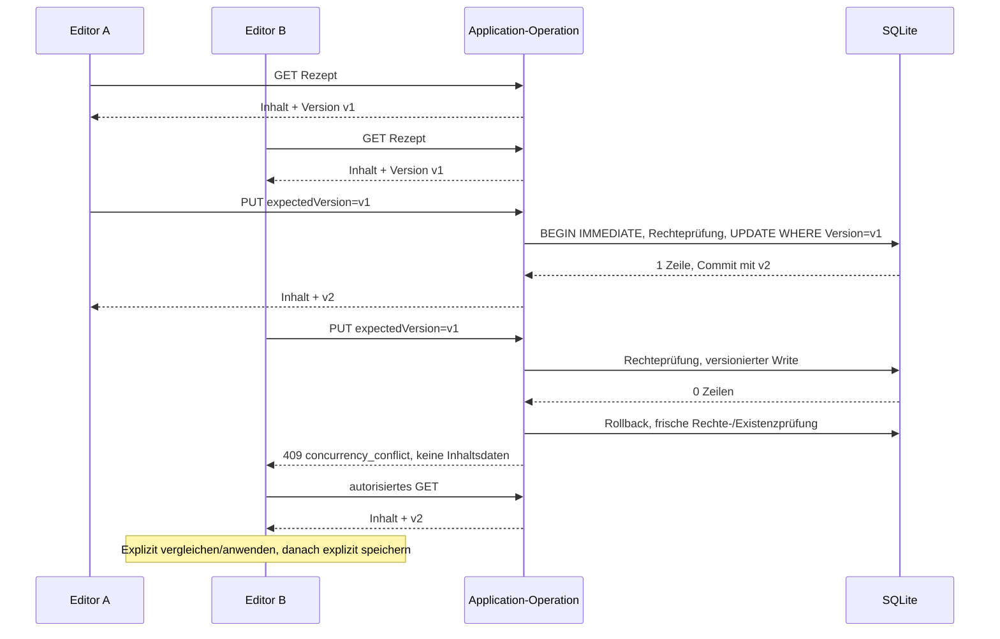

# Gemeinsames Bearbeiten: Vertrag, Betrieb und Prüfung

## Ausgangspunkt und Verantwortung

Step 6 wurde ausschließlich auf den vorhandenen `feature/shared-editing`-Branches umgesetzt. Saubere Ausgangscommits: Backend `0ce197661b0760d1300cce3efcff097715f2e492`, Frontend `8e841b24d8285deefeb8c116b75c02fb0b42728c`. Beide enthielten die abgeschlossenen Accounts-/Cookbook-/UI-Änderungen und den Recipoke-Rename. Es war kein Merge/Rebase erforderlich; `main` wurde nicht geändert. Baseline: beide Builds, 621 Console-, 300 HTTP- und 181 Frontendprüfungen erfolgreich.

[ADR 014](architecture/adr/014-optimistic-concurrency.md) begründet die Entscheidung. EF-CAS und Transaktionen schützen Writes; Angular steuert ausschließlich die Benutzerentscheidung. Backend ist Eigentümer des OpenAPI-Snapshots; beide Repository-Diffs und Releases müssen koordiniert werden. Kein Token ist ein Berechtigungsnachweis.



## Mutationstabelle

Routen bleiben vorhanden; Cookie, `X-RecipeAtlas: 1`, Rollen, Mengenstrings/Units und Nullability bestehender Felder bleiben erhalten.

| Operation | Erwartung | Erfolg |
|---|---|---|
| Recipe-PUT | JSON `expectedVersion` | 200 Rezept mit `version` |
| Recipe-DELETE | starkes `If-Match` | 204 |
| Recipe-Bild PUT/DELETE | starkes `If-Match` | 200 `{ imageUrl, version, updatedAtUtc }` |
| Cookbook-PUT | JSON `expectedVersion` | 200 Cookbook mit `version` (bisher 204) |
| Cookbook-DELETE | starkes `If-Match` | 204 |
| Cookbook-Cover PUT/DELETE | starkes `If-Match` | 200 Cookbook (DELETE bisher 204) |
| Member-POST, Rollen-PUT | JSON `expectedVersion` | 200 `{ version }` (bisher 204) |
| Member-/Invite-DELETE | starkes `If-Match` | 200 `{ version }`; Selbstentfernung 204 |
| Leave-POST | JSON `expectedVersion` | 204, keine Inhalte nach Zugriffsentzug |
| Invite-Antwort POST | JSON `accept`, `expectedVersion` aus `cookbookVersion` der Inbox | 204 |

Recipe- und Cookbook-GET/Create liefern zusätzlich `version`; Members-GET liefert jetzt `{ cookbook, members }`. Inbox-Repräsentationen enthalten `cookbookVersion`. Recipe-Listen bleiben effiziente Read-only-Karten ohne Update-Token; vor Bearbeitung wird die Detailrepräsentation geladen. Initiale Einladungen bei Cookbook-Erstellung gehören zur Erstellung, nicht zu einem Write an einem bestehenden Aggregat.

Fehlender Token führt zu 428, ein ungültiger/leer übergebener JSON-Token zu 400. Einzelner starker Header: `If-Match: "aabbccdd-...."`, keine Wildcard, kein `W/`, keine Liste. JSON-Konflikt: 409; Headerkonflikt: 412; beide `code: concurrency_conflict` im bestehenden Fehlerformat. 401/403/404 für Session, Rolle und unzugänglichen Scope bleiben maßgeblich. Auth-Prüfungen werden nach fehlgeschlagenem CAS und Rollback wiederholt. Transportfehler, Mengenvalidierung und vorhandene Bildgrößen-/Signaturprüfungen bleiben eigene Fehlerfälle. Kein pauschales Umdeuten anderer DB-Fehler.

## Editor und partielle Speicherung

Baseline und neu geladene Serverfassung sind getrennte Zustände des jeweiligen Editors. FormControls enthalten keine Version. Zutaten und Schritte werden jeweils als vollständige geordnete Sektion gewählt; es gibt keinen elementweisen oder automatischen Merge. Auch ungültige lokale Rohtexte werden beim Vergleichen nicht heimlich kanonisiert. Ein fehlgeschlagenes GET ist keine Konfliktauflösung. Bei 403/404 bleiben lokale Rezeptfelder als kopierbarer Text verfügbar; Bildblobs bleiben im aktuellen Editor erhalten. Es gibt keine private localStorage-Kopie. Session-/Accountwechsel verwirft private Zustände; verspätete Antworten werden anhand Sessionepoch/Lebensdauer ignoriert.

Ein Textsave und ein Bildsave sind ausdrücklich **keine** gemeinsame HTTP-Transaktion. Der erste kann erfolgreich sein, während der zweite wegen Netzwerk, Rechten oder inzwischen geänderter Version scheitert. Die UI zeigt dies als partielle Speicherung, behält ID/Version der erfolgreichen Antwort und das ausstehende Bild. Ein erneuter Save ohne neue Textänderungen sendet nur das Bild. Nach Review ist eine erneute explizite Entscheidung erforderlich. Dasselbe gilt für Cookbook-Details und Cover. Dialoge stapeln Vergleiche unter 600px, erlauben Scrollen und Tastaturbedienung; Quellenwahl ist beschriftet, ohne Vorauswahl für tatsächlich wählbare Alternativen.

Memberaktionen verwenden die Version der angezeigten Membership-Liste, niemals einen unmittelbar vor dem Write beschafften neueren Token. Ungespeicherte Metadaten/Cover sperren Memberaktionen bis Save oder bestätigtem Discard. Nach einem Memberkonflikt wird die gesamte kohärente Anzeige erneuert, jedoch keine Aktion wiederholt. Ein veraltetes Recipe-/Cookbook-Delete lädt den aktuellen erlaubten Stand und verlangt eine neue Auswahl und Bestätigung. Eine Cookbook-Version umfasst absichtlich keine Rezeptänderungen: das bestätigte Cookbook-Delete entfernt alle im Scope enthaltenen Inhalte, die angezeigte Anzahl ist kein eingefrorener Snapshot aller Rezeptversionen.

## Upgrade und Rollback

1. Schreibzugriffe stoppen und alte API-Prozesse beenden. Ein konsistentes vollständiges Backup von `recipes.db` und dem bestehenden Data-Protection-Key-Verzeichnis anlegen; bei WAL-Betrieb ein SQLite-Backupverfahren oder einen vollständig beendeten/checkpointed Datenbestand verwenden. Auch Deploymentkonfiguration sichern. Nicht nur einzelne Tabellen kopieren.
2. Backend und Frontend aus den passenden `feature/shared-editing`-Commits bauen/testen. Keine Dependency-Upgrades sind erforderlich. Dateien/Remote-URLs/Connection-Konfiguration und `DataDirectory` bleiben bestehen.
3. Migration `20261018164322_OptimisticAggregateVersions` auf den gesicherten Bestand anwenden. Die bestehende Startup-Migration bleibt kompatibel aktiv. Alternativ kontrolliert vor Startup:

   ```sh
   dotnet ef database update --project backend/RecipeAtlas.Api --connection 'Data Source=/absolute/existing/data/recipes.db;Foreign Keys=True'
   ```

   Dieser Befehl ist ein bewusster Deployment-Schritt, **kein** Testbefehl für Benutzerdaten.
4. Passendes Frontend und Backend gemeinsam bereitstellen. Bereits angemeldete Sitzungen/Keyring bleiben verwendbar; alte Browser-Tabs müssen neu geladen werden. Alte Clients ohne Version erhalten 428 und dürfen nicht auf unbedingte Writes zurückfallen.
5. Smoke mit synthetischem Inhalt durchführen, danach Schreibzugriff freigeben. Nie die alte Backendversion neben der neuen ausführen: sie würde Versionen nicht beachten. `Down` verweigert einen Schemarollback. Rückkehr erfordert die zusammengehörigen alten Binaries/SPA **und** das vollständige Vor-Upgrade-Backup; nach dem Backup entstandene Daten würden dabei verloren gehen und müssen betrieblich behandelt werden.

## Automatisierte Verifikation

Aus dem Backend-Root, .NET SDK 10.0.401 und Python 3; EF-Tool 10.0.12 ist lokal gepinnt:

```sh
dotnet restore --locked-mode
dotnet tool restore
dotnet build --no-restore
dotnet run --no-build --project tests/Recipoke.Tests
python3 tests/integration.py
python3 tests/accounts_integration.py
python3 tests/ui_support_integration.py
python3 tests/concurrency_integration.py
python3 scripts/publish_pre_concurrency.py /tmp/recipoke-before-concurrency
python3 tests/concurrency_upgrade.py /tmp/recipoke-before-concurrency/Recipoke.Api.dll
python3 tests/test_contract_paths.py
dotnet ef migrations list --no-connect --no-build --project backend/RecipeAtlas.Api
dotnet ef migrations has-pending-model-changes --no-build --project backend/RecipeAtlas.Api
python3 scripts/export_openapi.py --check
python3 tests/check_shared_contracts.py /absolute/frontend/root
python3 scripts/sync_frontend_contracts.py /absolute/frontend/root --check
```

Der Publish-Befehl benötigt ein **leeres** Ausgabeverzeichnis und den gepinnten Ausgangscommit in der lokalen Git-Historie. Er archiviert nur diese Repositoryversion in ein temporäres Verzeichnis, kein neues Worktree/Branch. Upgrade prüft jeden alten Spaltenwert, IDs, akzeptierte Memberships, Mengen/Sortierung, Bildbytes, Keydateien, tatsächlich weiter nutzbare Cookies und genau eine zusätzliche Migration. Kein Test öffnet Benutzer-Datenbanken. `dotnet test` ersetzt den Console-Runner nicht. `--no-connect` kann absichtlich keinen angewendeten Pending-Status ermitteln.

Frontend-Root, Node 24.19.0:

```sh
npm ci
npm run check:contracts
npm test
npm run build
node tests/browser-accounts-smoke.mjs /absolute/backend/root /path/to/chromium
```

Der letzte Befehl ist optional und benötigt beide lokalen Checkouts und Chromium; CI ruft ihn nicht ohne diese Voraussetzungen vorgeblich auf. Beide CI-Workflows verwenden `contents: read`, echte Runner und lokale Snapshots. Backend-CI baut den gepinnten Vorversionsstand aus eigener Historie und prüft das tatsächliche Upgrade. Keine Secrets/Benutzerdaten als Artefakte. HTTP-Racetests verwenden Barrieren; der deterministische Berechtigungsrace verwendet Transaktionsinterzeption statt beliebiger Sleeps. Warteintervalle in Server-/Browser-Readiness betreffen nur den Testprozessstart bzw. Animationen.

## Zwei-Sitzungen-Demonstration

1. API mit `dotnet run --project backend/RecipeAtlas.Api --launch-profile http`, Frontend mit `npm start` starten. Zwei getrennte Browserprofile/Privatkontexte verwenden. Owner und eingeladener Editor müssen dasselbe Cookbook sehen; Einladung vorher annehmen.
2. Beide öffnen dasselbe Rezept zum Bearbeiten. A ändert Titel, Zutatenreihenfolge und Schritte und speichert. B verändert lokalen Titel und Foto und speichert. Erwartet: Konflikt, keine Navigation, lokale Eingaben/Foto bleiben. A-Inhalte bleiben auf dem Server unverändert.
3. B öffnet **Review changes**, wählt lokale/serverseitige Skalare und ganze Zutaten-/Schrittesektionen. Anwenden speichert noch nicht und lässt den Entwurf dirty. A speichert erneut. B speichert den besprochenen Entwurf: erneut Konflikt. Neu vergleichen, dann explizit speichern. **Load server version…** zuvor mit Cancel und bestätigtem Discard prüfen.
4. Netzwerk nach erfolgreichem Textsave, vor Fotofinish unterbrechen. Erwartet: Text bereits gespeichert, Foto ausstehend, kein zweites Rezept. Netzwerk wiederherstellen und explizit erneut speichern: nur Foto wiederholen, sofern Text nicht weiter geändert wurde. Alternativ A zwischen Text und Foto speichern lassen: Foto-412 führt in denselben Review-Ablauf.
5. Zwei Ownersitzungen öffnen Cookbook-Settings. A ändert eine Mitgliedsrolle; B versucht eine Umbenennung oder Memberaktion vom alten Stand. Erwartet: Metadaten bleiben lokal, Memberkonflikt lädt nur neu und verlangt eine neue Aktion. Bei dirty Metadaten sind Memberaktionen blockiert.
6. B öffnet ein Delete-Confirm; A ändert das zugehörige Aggregat. B bestätigt: 412, Inhalt bleibt. Aktuellen Stand prüfen und neu bestätigen. Owner-Delete umfasst wie bisher sämtliche Cookbook-Rezepte/Bilder; Recipe-Edit allein ändert keine Cookbook-Version.
7. A stuft B zu Viewer zurück, entfernt B oder deaktiviert dessen Account. B versucht zu speichern: 403/404/401 gemäß Berechtigung; keine aktuellen privaten Konfliktdetails. Lokale Rezeptfelder bleiben kopierbar. Accountwechsel beendet alte private Editorzustände.
8. Bei 320px/390px: Dialog scrollen, lange Zutaten/Schritte, Radiogruppen mit Tab/Pfeiltasten/Space, Cancel/Apply und Rückkehrfokus prüfen. Keine horizontale Zweispaltenpflicht, erreichbare Aktionen. Physische Geräte, öffentlicher TLS-/Containerbetrieb und Live-Importprovider sind separate Nachweise.

## Tatsächlich ausgeführte Nachweise (2026-10-18)

- Backend: Restore/Build ohne Warnungen/Fehler; expliziter Console-Runner **627** Prüfungen einschließlich SQLite/CAS/Architektur. HTTP: **63 + 159 + 78 + 111 = 411**; der neue Anteil umfasst zwei koordinierte Owner-/Memberraces, Einladungs-Versionen, Bild-/Child-Rollback und Autorisierung.
- Upgrade: echter gepinnter Vorversions-Publish wurde zusätzlich aus Git-Historie reproduziert. Der Upgrade-Test bestand mit diesem Publish und dem zuvor archivierten Publish. Auch der bestehende Single-Owner-Upgrade-Test bestand mit dem vorhandenen historischen Publish einschließlich geschlossener Setup-Phase/Recovery/Production-Cookieattributen. Der optionale ältere Accounts-vor-UI-Test wurde an zusätzliche Versionsfelder/Migrationshistorie angepasst, in diesem Step aber nicht separat ausgeführt, da kein entsprechender Publish bereitlag.
- EF: fünf Migrationen entdeckt; kein ausstehender Modellunterschied. `--no-connect` öffnete keine Benutzerdatenbank. Vier Contract-Pfadtests, generierter Development-OpenAPI-Vergleich samt Production-404 und beide lokalen Cross-Repository-Vergleiche bestanden.
- Frontend: Vertragschecker **191** Typ-/Nullability-Prüfungen; Produktionsbuild mit **757,00 kB** initialer Rohgröße unter unveränderter Warnschwelle. **202** Frontendtests in 16 Dateien bestanden, einschließlich Expiry-/Partial-Save-Regressionen.
- Chromium: **78** automatisierte Prüfungen mit zwei isolierten Benutzersitzungen bei 320/390/899/900/1280px. Enthalten: echter Stale-Save, erhaltener lokaler Titel, Cancel/Apply, komplette serverseitige Schrittsektion, kein automatischer Save, neuer expliziter Save, Radiowahl mit Space/Pfeiltasten, Dialog-/Rückkehrfokus und schmale scrollbare Darstellung. Der 320px-Review-Screenshot wurde zusätzlich angesehen. Der Browsernachweis deckt nicht jede deterministisch in Unit-/HTTP-Tests injizierte Race-/Netzwerkvariante ab.

Die Browserprüfung fand eine tatsächliche Angular-22-Grenze: die gewählte Server-Schrittesektion lag im Formular, während das mutable FormArray-Kind noch alte Controls darstellte. `IngredientEditorComponent`/`StepEditorComponent` verwenden deshalb explizit `ChangeDetectionStrategy.Eager`; Form-/Review-Eigentum bleibt unverändert. Es wurde kein zusätzlicher Synchronisationszustand eingeführt. Abgelaufene Editor-Sitzungen behalten lokale Felder und ausstehende Bilder, während private Serverbaselines gelöscht und Saves gesperrt werden; expliziter Accountwechsel verwirft die lokalen Daten. Zugriffsverlust während eines Bildrequests verschweigt den zuvor erfolgreichen Textsave nicht.

Kein gehosteter GitHub-Actions-Lauf, Live-Importprovider, physisches Gerät oder öffentliches Deployment wurde als geprüft ausgegeben. Es wurde keine Benutzerdatenbank geöffnet, migriert oder ersetzt. Kein neues Paket und keine Änderung an Framework-/Tool-Pins.


## Windows: Lebensdauer synthetischer SQLite-Verbindungen

Die HTTP-Assertions konnten bereits erfolgreich sein, während `TemporaryDirectory` anschließend mit `WinError 32` scheiterte: `sqlite3.Connection.__exit__` beendet die Transaktion, schließt aber die Verbindung nicht. Auf Unix kann eine offene Datei entfernt werden; Windows verhindert das. Das war ein Fehler der Python-Testressourcen, kein fehlgeschlagener fachlicher Concurrency-Check.

Accounts-, UI-Support-, Concurrency- und die zugehörigen Upgrade-Skripte verwenden nun `with closing(sqlite3.connect(...)) as db, db:`. Die innere Transaktion behält Commit/Rollback bei, die äußere Ressource wird danach auch bei Ausnahmen geschlossen. Cleanup-Fehler werden nicht unterdrückt, Garbage Collection und willkürliche Retry-Sleeps sind keine Lösung.

`python tests/test_sqlite_cleanup.py` führt die drei betroffenen HTTP-Suiten aus und hält ihre echten Python-Verbindungen absichtlich referenziert. Danach muss ein weiterer SQL-Zugriff wegen geschlossener Verbindung scheitern. So erkennt auch Linux die zuvor verdeckte fehlende Freigabe. Die Linux-CI führt die drei Suiten über diesen Runner einmalig statt doppelt aus; ein zusätzlicher Windows-2025-Job mit Python 3.14 und unverändertem .NET-SDK prüft native Dateisperren. Ein gehosteter Windows-Lauf ist erst nach dessen tatsächlichem Abschluss belegt. Backend-Laufzeit, Schema, Mengenregeln und Frontend ändern sich dadurch nicht.

Lokaler Nachweis dieser Korrektur: drei erfolgreiche Connection-Lifetime-Prüfungen mit insgesamt 348 bestehenden HTTP-Assertions (159 Accounts, 111 Concurrency, 78 UI-Support), beide vorhandenen Binär-Upgrades vom Single-Owner- und unmittelbaren Vorversionsstand erfolgreich. Eine negative Probe deaktivierte das Schließen bewusst: die HTTP-Assertions bestanden, der neue Ressourcencheck schlug wie vorgesehen fehl. Native Windows-Verifikation bleibt dem hinzugefügten CI-Job bzw. dem lokalen erneuten Lauf vorbehalten.
